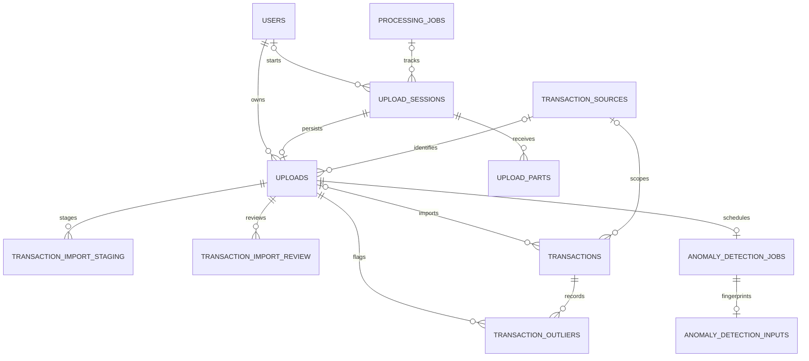

# Schema sistemului de upload CSV

Acest document descrie tabelele definite sau extinse de [upload_system.sql](upload_system.sql).
Scriptul se bazează pe schema principală creată de `db/create_schema.sql`; tabelele
`users`, `processing_jobs`, `transactions`, `merchants` și `card_schemes` trebuie să existe deja.

## Diagramă relațională

Diagrama include și `users`, `processing_jobs` și `transactions`, care există în schema
principală. `transactions` este extins de scriptul de upload.

`o|` indică o legătură opțională, `||` o singură înregistrare obligatorie, iar `o{`
zero sau mai multe înregistrări.

## Tabele

| Tabel | Rol | Legături principale |
| --- | --- | --- |
| `transaction_sources` | Catalogul surselor de tranzacții, de exemplu banca sau procesatorul din care provine un fișier. `normalized_name` este unic, pentru ca aceeași sursă să poată fi recunoscută consecvent. | O sursă poate fi asociată mai multor `uploads` și `transactions`. |
| `upload_sessions` | Înregistrează încercarea de upload și starea ei: fișierul așteptat, progresul pe bucăți, numărul de rânduri procesate, rezultatul și erorile. Păstrează și timpii etapelor importului. | Opțional, indică utilizatorul și un `processing_job`; are mai multe `upload_parts` și cel mult un `uploads`. |
| `upload_parts` | Metadatele fiecărei bucăți primite: număr, dimensiune, SHA-256 și calea de stocare temporară. Împiedică înregistrarea de două ori a aceleiași bucăți într-o sesiune. | Aparține unei `upload_sessions`; se șterge odată cu sesiunea. |
| `uploads` | Reprezintă fișierul importat și păstrează documentul, proprietarul, sursa, momentul încărcării, hash-ul fișierului și starea evaluării. Este înregistrarea la care se atașează tranzacțiile importate. | Aparține unui utilizator și unei sesiuni; poate indica o `transaction_sources`. Unicitatea sesiunii permite cel mult un upload per sesiune, iar hash-ul fișierului este unic per utilizator și sursă. |
| `transactions` *(tabel existent, extins de script)* | Leagă tranzacțiile importate de uploadul, utilizatorul și sursa lor. `upload_id` rămâne opțional pentru tranzacțiile istorice sau introduse prin alte fluxuri. | `upload_id` indică `uploads`; `user_id` și `source_id` păstrează proprietarul și proveniența. Indexul unic aplică deduplicarea după utilizator, sursă și `external_id`. |
| `transaction_import_staging` | Zonă temporară pentru rândurile CSV parsate și validate în loturi. Importul final ajunge în tabelele aplicației după validarea completă a fișierului; câmpurile `is_duplicate` și `duplicate_*` marchează duplicatele. | Rândurile sunt identificate de perechea `(upload_id, row_number)` și aparțin unui `uploads`. Tabelul este `UNLOGGED`, deci nu este stocare durabilă la crash. |
| `transaction_import_review` | Stocare durabilă pentru rândurile care așteaptă decizia analistului privind duplicatele. Păstrează datele tranzacției și motivul/linkurile duplicatei chiar dacă staging-ul este golit. | Folosește aceeași cheie `(upload_id, row_number)` ca staging-ul și aparține unui `uploads`. |
| `transaction_outliers` | Rezultatele de anomalie asociate tranzacțiilor dintr-un upload, inclusiv dacă analistul le-a confirmat manual și când. | Leagă un `uploads` de o `transactions`; combinația upload–tranzacție este unică. |
| `anomaly_detection_jobs` | Starea jobului asincron de detectare a anomaliilor pentru un upload: în așteptare, în execuție, completat sau eșuat. | Există cel mult un job per `uploads`; se șterge odată cu uploadul. |
| `anomaly_detection_inputs` | Amprenta (`fingerprint`) a intrărilor folosite de un job, pentru a putea identifica dacă rezultatele mai corespund datelor curente. | Are relație unu-la-unu cu `anomaly_detection_jobs`, prin `job_id`. |

## Fluxul datelor

1. `upload_sessions` urmărește sesiunea, iar fiecare bucată primită este înregistrată în
   `upload_parts`.
2. După primirea fișierului, `uploads` păstrează documentul și metadatele lui. Hash-ul
   SHA-256 este folosit pentru detectarea aceluiași fișier încărcat de același utilizator
   pentru aceeași sursă.
3. Rândurile CSV sunt procesate temporar în `transaction_import_staging`. Dacă importul
   necesită o decizie despre duplicate, rândurile sunt păstrate în `transaction_import_review`
   până la confirmarea analistului.
4. Tranzacțiile importate sunt asociate în `transactions` cu uploadul și sursa lor. Un
   `transaction_sources` comun permite deduplicarea tranzacțiilor între fișierele aceleiași
   surse pentru același utilizator.
5. Detectarea anomaliilor folosește `anomaly_detection_jobs` și amprenta din
   `anomaly_detection_inputs`; rezultatele apar în `transaction_outliers`.

## Sesiuni și timpi

Valorile actuale ale `upload_sessions.status` sunt `UPLOADING`, `QUEUED`, `PROCESSING`,
`DUPLICATES_FOUND`, `COMPLETED`, `DUPLICATE`, `FAILED` și `CANCELLED`. Timpul total se
păstrează pe sesiune și, când există înregistrarea fișierului, și pe `uploads`. Timpii
intermediari măsoară primirea bucăților, persistența documentului, parsarea și validarea
CSV-ului, scrierea în staging și merge-ul final.

Scriptul extinde și `transactions`; nu creează de la zero tabelele principale ale
aplicației. Pentru schema inițială, execută mai întâi `db/create_schema.sql`, apoi
`db/csvuploads/upload_system.sql`.
